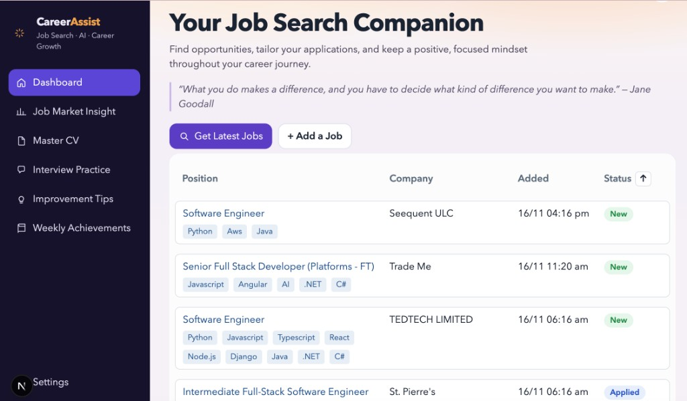
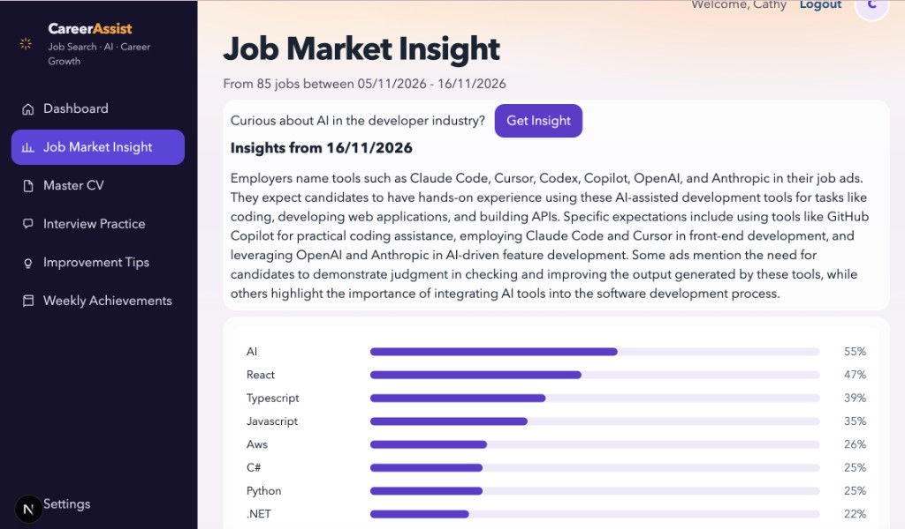
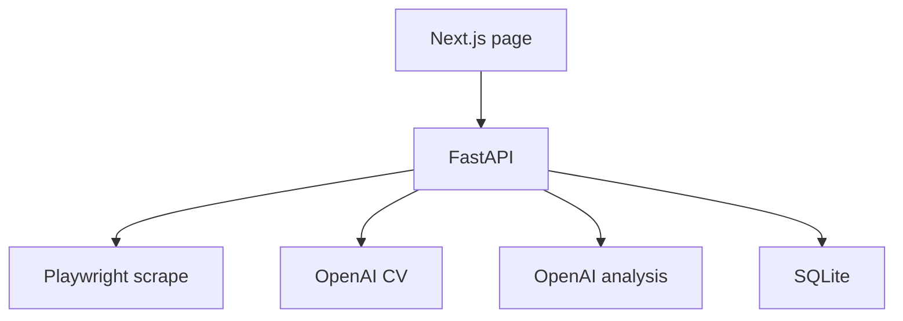

# CareerAssist

An app to track and analyse the **tech job market** and help developers stay on top of the trend. It provides toolkits such as CV generation, applications, interview practices, and learning resources.



**Job Market Insight** reads the stored ads and asks the model which AI tools employers name, and what they expect someone to do with them.



The browser talks only to the API. Playwright and the OpenAI calls stay behind that API, and only the API writes to the database.


## Tech stack

- **Python 3.9.6.** The API, Seek scraping, CV generation, and database access are written in Python.
- **Next.js 15 and React 19.** The pages are TypeScript. The browser talks to the API with `fetch` and sends the login token on each request as an `Authorization: Bearer` header.
- **FastAPI.** The REST API covers jobs, Seek scraping, CV generation, market insight, and accounts. Request bodies are checked with Pydantic.
- **Uvicorn.** It serves the API on `127.0.0.1:8765`.
- **SQLite.** One file, `jobs.sqlite`, holds jobs, users, sessions, and interview notes. The API is the only writer.
- **Playwright.** A headless Chromium browser scrapes one page of developer jobs from Seek New Zealand.
- **OpenAI.** The same API key writes a tailored CV summary and a short paragraph on which AI tools the stored ads mention.
- **Jinja2.** CV HTML is rendered from `master_cv.json` into `CV_{company}_{id}.html`.
- **Account sessions.** Passwords are hashed with PBKDF2-SHA256. Login returns a bearer token stored in the browser.

Cursor with Grok 4.7 is the editor this was built in. It is not part of the running app.



## Layout

| Piece | Where |
|---|---|
| Page | `frontend/app/page.tsx` |
| Routes | `backend/app/main.py` |
| SQLite | `backend/app/models/jobs.py` |
| Seek scrape | `backend/app/services/scrape.py` |
| CV generation | `backend/app/services/cv.py` |
| Insight page | `frontend/app/insight/page.tsx` |
| AI analysis | `backend/app/services/insight.py` |
| Master CV page | `frontend/app/cv/page.tsx` |
| Master CV routes | `GET /master-cv`, `PUT /master-cv/current-highlights` |

Scraped jobs and hand-added jobs live in one SQLite table. A later scrape adds Seek ids it has not stored yet and leaves existing rows as they are, so Applied and Removed stay put.

## Analyse on Job Market Insight 

The app scans those stored ads, including removed ones, for Claude Code, Cursor, Codex, Copilot, ChatGPT, OpenAI, and Anthropic. It sends the matching titles, companies, and a short requirements excerpt to the model, which returns one plain-text paragraph. The call uses the same `OPENAI_API_KEY`. If none of the ads name those tools, the page says so and does not call the model.

## Run

Use two terminals from the repository root.

```bash
cd backend && ../venv/bin/uvicorn app.main:app --host 127.0.0.1 --port 8765
```

```bash
cd frontend && npm run dev
```

Open http://localhost:3000. The API is at http://127.0.0.1:8765.

Get Latest Jobs scrapes one page of developer jobs in New Zealand. That takes a few minutes, and a second click while it is running is ignored.

## Containers

`docker compose up --build` runs the same two processes. The site is still http://localhost:3000, and the API is published on http://127.0.0.1:8765. `jobs.sqlite`, `.env`, and `master_cv.json` stay on your machine. They are mounted into the API container and are not copied into the image.

The API image listens on `0.0.0.0` and on `PORT` (8765 under Compose, 8080 on Cloud Run). The frontend image bakes `NEXT_PUBLIC_API_URL` in at build time, because the browser calls that address.

## Continuous integration

A push to [career-assist](https://github.com/pscientist/career-assist) builds both images and checks that the API answers `GET /health`. The deploy job runs after that, on `main`, once the GitHub secrets below are set.

## Cloud Run

The same workflow deploys to Cloud Run in `australia-southeast1` after the images build, and only when these GitHub Actions secrets exist:

| Secret | Value |
|---|---|
| `GCP_PROJECT_ID` | The Google Cloud project id |
| `GCP_SERVICE_ACCOUNT` | `career-assist-deploy@PROJECT_ID.iam.gserviceaccount.com` |
| `GCP_WORKLOAD_IDENTITY_PROVIDER` | `projects/PROJECT_NUMBER/locations/global/workloadIdentityPools/github/providers/github` |

Create those once, from a machine where `gcloud` is logged in. Replace `PROJECT_ID` and leave the repository as `pscientist/career-assist`.

```bash
PROJECT_ID=your-project
REGION=australia-southeast1
REPO=pscientist/career-assist

gcloud services enable run.googleapis.com artifactregistry.googleapis.com iamcredentials.googleapis.com iam.googleapis.com secretmanager.googleapis.com
gcloud artifacts repositories create career-assist --repository-format=docker --location=$REGION

gcloud iam service-accounts create career-assist-deploy --display-name="CareerAssist deploy"
SA=career-assist-deploy@$PROJECT_ID.iam.gserviceaccount.com
gcloud projects add-iam-policy-binding $PROJECT_ID --member="serviceAccount:$SA" --role="roles/run.admin"
gcloud projects add-iam-policy-binding $PROJECT_ID --member="serviceAccount:$SA" --role="roles/artifactregistry.writer"
gcloud projects add-iam-policy-binding $PROJECT_ID --member="serviceAccount:$SA" --role="roles/iam.serviceAccountUser"

gcloud iam workload-identity-pools create github --location=global --display-name="GitHub"
gcloud iam workload-identity-pools providers create-oidc github \
  --location=global --workload-identity-pool=github --display-name="GitHub" \
  --attribute-mapping="google.subject=assertion.sub,attribute.repository=assertion.repository" \
  --issuer-uri="https://token.actions.githubusercontent.com"

PROJECT_NUMBER=$(gcloud projects describe $PROJECT_ID --format='value(projectNumber)')
gcloud iam service-accounts add-iam-policy-binding $SA \
  --role="roles/iam.workloadIdentityUser" \
  --member="principalSet://iam.googleapis.com/projects/$PROJECT_NUMBER/locations/global/workloadIdentityPools/github/attribute.repository/$REPO"
```

The deploy service account email and the provider resource name are the three secrets above. A push to `main` then publishes both images and deploys `career-assist-api` and `career-assist-web`. The frontend is built with the API's Cloud Run URL, and the API allows that frontend origin.

Put the model key in Secret Manager so the API revision can read it. The Cloud Run runtime account needs access to that secret.

```bash
gcloud secrets create OPENAI_API_KEY --replication-policy=automatic
printf '%s' "$OPENAI_API_KEY" | gcloud secrets versions add OPENAI_API_KEY --data-file=-
gcloud secrets add-iam-policy-binding OPENAI_API_KEY \
  --member="serviceAccount:${PROJECT_NUMBER}-compute@developer.gserviceaccount.com" \
  --role="roles/secretmanager.secretAccessor"
```

The SQLite file on Cloud Run does not survive a new instance. Accounts and jobs created there disappear when Cloud Run replaces the container. That is expected for this deploy. Cloud SQL is a later project.

## Setup

```bash
python3 -m venv venv
./venv/bin/pip install -r backend/requirements.txt
./venv/bin/playwright install chromium
cd frontend && npm install
```

Put `OPENAI_API_KEY` in `.env` at the repository root. Put the master CV in `master_cv.json` beside it. Generating a CV reads that file, asks the model for a matching summary, copies each role's highlights from the master CV, and writes `CV_{company}_{id}.html`.
