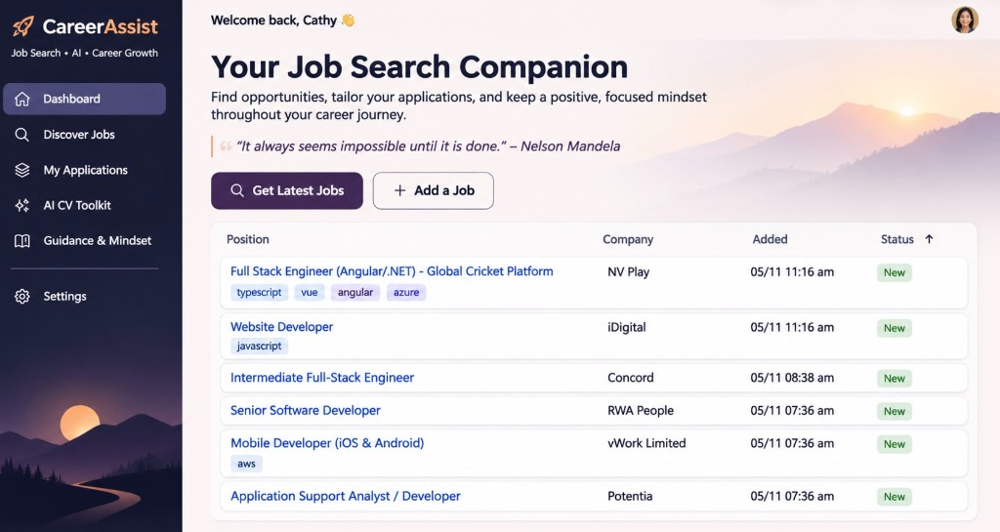
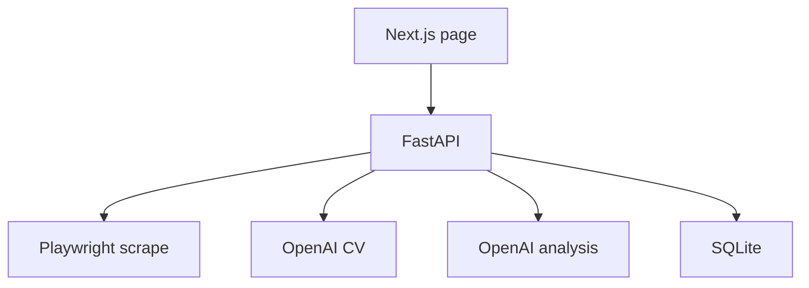

# CareerAssist

A personal app for tracking developer jobs on Seek and generating a tailored CV for one of them. The page lists the current positions. A scrape refreshes the listing. Each job can be marked New, Applied, or Interviewing, removed, or have ChatGPT generates the CV in HTML, from a "master CV" to tailor to the position.

Job Market Insight reads the stored ads and asks the model which AI tools employers name, and what they expect someone to do with them.

The browser talks only to the API. Playwright and the OpenAI calls stay behind that API, and only the API writes to the database.

## Tech stack

Python, React, JavaScript/TypeScript, OpenAI, SQL, Cursor





## Layout

| Piece | Where |
|---|---|
| Page | `frontend/app/page.tsx` |
| Routes | `backend/app/main.py` |
| SQLite | `backend/app/models/jobs.py` |
| Seek scrape | `backend/app/services/scrape.py` |
| CV generation | `backend/app/services/cv.py` |
| Insight page | `frontend/app/insight/page.tsx` |
| AI analysis | `backend/app/services/insight.py` |
| Master CV page | `frontend/app/cv/page.tsx` |
| Master CV routes | `GET /master-cv`, `PUT /master-cv/current-highlights` |

Scraped jobs and hand-added jobs live in one SQLite table. A later scrape adds Seek ids it has not stored yet and leaves existing rows as they are, so Applied and Removed stay put.

## Analyse on Job Market Insight 

The app scans those stored ads, including removed ones, for Claude Code, Cursor, Codex, Copilot, ChatGPT, OpenAI, and Anthropic. It sends the matching titles, companies, and a short requirements excerpt to the model, which returns one plain-text paragraph. The call uses the same `OPENAI_API_KEY`. If none of the ads name those tools, the page says so and does not call the model.

## Run

Use two terminals from the repository root.

```bash
cd backend && ../venv/bin/uvicorn app.main:app --host 127.0.0.1 --port 8765
```

```bash
cd frontend && npm run dev
```

Open http://localhost:3000. The API is at http://127.0.0.1:8765.

Get Latest Jobs scrapes one page of developer jobs in New Zealand. That takes a few minutes, and a second click while it is running is ignored.

## Setup

```bash
python3 -m venv venv
./venv/bin/pip install -r backend/requirements.txt
./venv/bin/playwright install chromium
cd frontend && npm install
```

Put `OPENAI_API_KEY` in `.env` at the repository root. Put the master CV in `master_cv.json` beside it. Generating a CV reads that file, asks the model for a matching summary, copies each role's highlights from the master CV, and writes `CV_{company}_{id}.html`.
