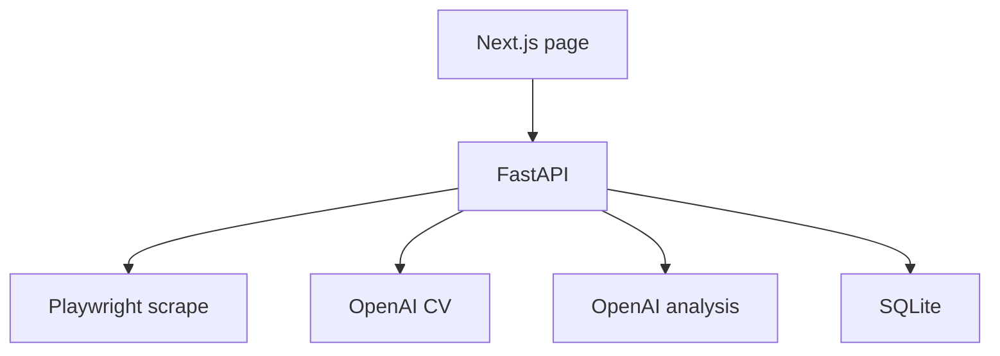

# CareerAssist

An app to track and analyse the **tech job market** and help developers stay on top of the trend. It provides toolkits such as CV generation, applications, interview practices, and learning resources.


**Job Market Insight** reads the stored ads and asks the model which AI tools employers name, and what they expect someone to do with them.


The browser talks only to the API. Playwright and the OpenAI calls stay behind that API, and only the API writes to the database.


## Tech stack

- **Python 3.9.6.** The API, Seek scraping, CV generation, and database access are written in Python.
- **Next.js 15 and React 19.** The pages are TypeScript. The browser talks to the API with `fetch` and sends the login token on each request as an `Authorization: Bearer` header.
- **FastAPI.** The REST API covers jobs, Seek scraping, CV generation, market insight, and accounts. Request bodies are checked with Pydantic.
- **Uvicorn.** It serves the API on `127.0.0.1:8765`.
- **SQLite.** One file, `jobs.sqlite`, holds jobs, users, sessions, and interview notes. The API is the only writer.
- **Playwright.** A headless Chromium browser scrapes one page of developer jobs from Seek New Zealand.
- **OpenAI.** The same API key writes a tailored CV summary and a short paragraph on which AI tools the stored ads mention.
- **Jinja2.** CV HTML is rendered from `master_cv.json` into `CV_{company}_{id}.html`.
- **Account sessions.** Passwords are hashed with PBKDF2-SHA256. Login returns a bearer token stored in the browser.

Cursor with Grok 4.7 is the editor this was built in. It is not part of the running app.



## Layout

| Piece | Where |
|---|---|
| Page | `frontend/app/page.tsx` |
| Routes | `backend/app/main.py` |
| SQLite | `backend/app/models/jobs.py` |
| Seek scrape | `backend/app/services/scrape.py` |
| CV generation | `backend/app/services/cv.py` |
| Insight page | `frontend/app/insight/page.tsx` |
| AI analysis | `backend/app/services/insight.py` |
| Master CV page | `frontend/app/cv/page.tsx` |
| Master CV routes | `GET /master-cv`, `PUT /master-cv/current-highlights` |

Scraped jobs and hand-added jobs live in one SQLite table. A later scrape adds Seek ids it has not stored yet and leaves existing rows as they are, so Applied and Removed stay put.

## Analyse on Job Market Insight 

The app scans those stored ads, including removed ones, for Claude Code, Cursor, Codex, Copilot, ChatGPT, OpenAI, and Anthropic. It sends the matching titles, companies, and a short requirements excerpt to the model, which returns one plain-text paragraph. The call uses the same `OPENAI_API_KEY`. If none of the ads name those tools, the page says so and does not call the model.

## Run

Use two terminals from the repository root.

```bash
cd backend && ../venv/bin/uvicorn app.main:app --host 127.0.0.1 --port 8765
```

```bash
cd frontend && npm run dev
```

Open http://localhost:3000. The API is at http://127.0.0.1:8765.

Get Latest Jobs scrapes one page of developer jobs in New Zealand. That takes a few minutes, and a second click while it is running is ignored.

## Containers

Build both images from the repository root. The API image is `Dockerfile.api`. The frontend image is `Dockerfile.web`. Each Dockerfile copies its app from this directory, so the build context is `.`, not `backend/` or `frontend/`.

```bash
docker build -f Dockerfile.api -t career-assist-api .
docker build -f Dockerfile.web --build-arg NEXT_PUBLIC_API_URL=http://127.0.0.1:8765 -t career-assist-web .
```

`NEXT_PUBLIC_API_URL` is the address the browser uses to call the API. It is fixed into the frontend image at build time. Use `http://127.0.0.1:8765` on your machine.

Then start both containers:

```bash
docker compose up --build
```

Open http://localhost:3000. The API is published on http://127.0.0.1:8765. Compose builds the same two images if they are missing, and it mounts `jobs.sqlite`, `.env`, and `master_cv.json` into the API container.

You create `.env` and `master_cv.json` yourself. They stay in the repository root. `.env` holds `OPENAI_API_KEY`. `master_cv.json` is the master CV. Compose attaches both files when the API container starts. The image build leaves them out, and Git does not store them. On another machine, or in a deployment, you add those two files again by hand. The app writes each tailored CV as `CV_{company}_{id}.html` on that same machine.

Stop the local uvicorn and `npm run dev` processes first if they are already using ports 8765 and 3000.

The API process inside the container listens on `0.0.0.0` and on port 8765, so the published port answers.

## Setup

```bash
python3 -m venv venv
./venv/bin/pip install -r backend/requirements.txt
./venv/bin/playwright install chromium
cd frontend && npm install
```

Put `OPENAI_API_KEY` in `.env` at the repository root. Put the master CV in `master_cv.json` beside it. Generating a CV reads that file, asks the model for a matching summary, copies each role's highlights from the master CV, and writes `CV_{company}_{id}.html`.
