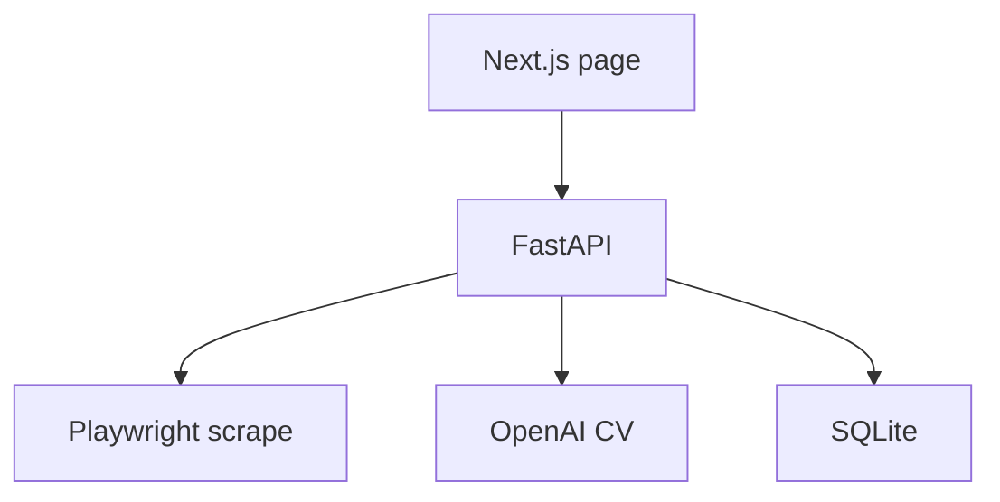

# CareerAssist

A personal app for tracking developer jobs on Seek and generating a tailored CV for one of them. The page lists the current positions. A scrape refreshes the listing. Each job can be marked New, Applied, or Interviewing, removed, or have ChatGPT generates the CV in HTML, from a "master CV" to tailor to the position.

The browser talks only to the API. Playwright and the OpenAI call stay behind that API, and only the API writes to the database.




## Layout

| Piece | Where |
|---|---|
| Page | `frontend/app/page.tsx` |
| Routes | `backend/app/main.py` |
| SQLite | `backend/app/models/jobs.py` |
| Seek scrape | `backend/app/services/scrape.py` |
| CV generation | `backend/app/services/cv.py` |

Scraped jobs and hand-added jobs live in one SQLite table. A later scrape updates the ad text and leaves the status as it is, so Applied and Removed stay put.

## Run

Use two terminals from the repository root.

```bash
cd backend && ../venv/bin/uvicorn app.main:app --host 127.0.0.1 --port 8765
```

```bash
cd frontend && npm run dev
```

Open http://localhost:3000. The API is at http://127.0.0.1:8765.

Get Latest Jobs scrapes one page of developer jobs in New Zealand. That takes a few minutes, and a second click while it is running is ignored.

## Setup

```bash
python3 -m venv venv
./venv/bin/pip install -r backend/requirements.txt
./venv/bin/playwright install chromium
cd frontend && npm install
```

Put `OPENAI_API_KEY` in `.env` at the repository root. Put the master CV in `master_cv.json` beside it. Generating a CV reads that file, asks the model for a tailored summary and experience bullets, and writes `CV_{company}_{id}.html`.
